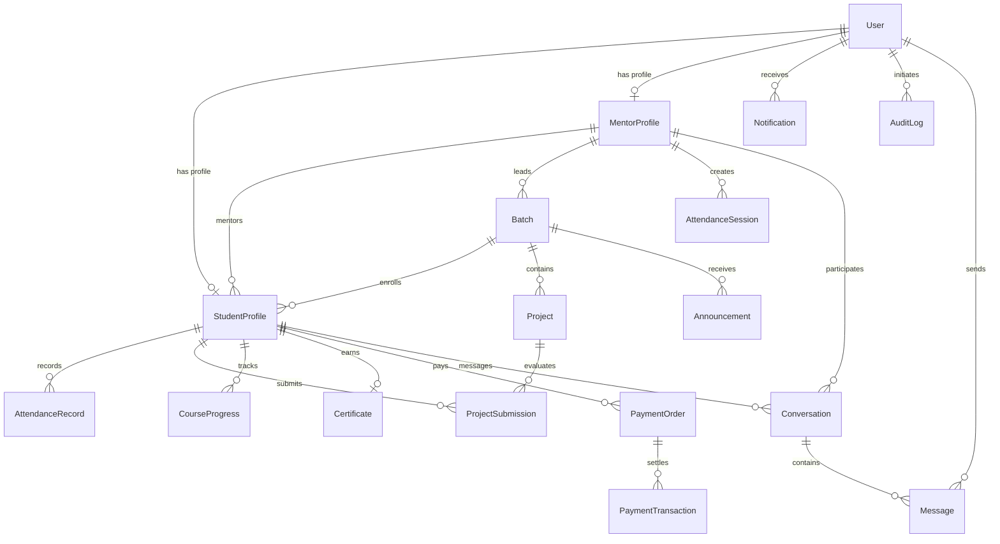

# Database Architecture: IVR Tech Solutions Internship Platform

This document describes the complete relational database architecture, table schemas, entity relationships, and storage mappings implemented in the platform.

---

## 1. Database Overview

* **Database Engine:** SQLite 3 (Development & Local Testing) / PostgreSQL 15+ (Production on AWS RDS)
* **ORM (Object-Relational Mapping):** Prisma ORM 5.22.0
* **Local Database File:** `prisma/dev.db` (defined via `DATABASE_URL="file:./dev.db"` in `.env`)
* **Production Database Name:** `ivrenterprise`
* **Total Tables / Relational Models:** 19 Models

---

## 2. Entity Relationship Diagram (ERD)

---

## 3. Detailed Table Dictionary

### 1. `User` (Authentication & Base Identity)
Stores user credentials, contact details, account status, and role-based permissions.
* **`id`** (String, Primary Key): Unique UUID.
* **`adminId`** (String, Unique, Optional): Unique Administrator identifier (e.g. `IVR-ADM-001`, `IVR-ADM-002`).
* **`email`** (String, Unique): Normalized lowercase login email.
* **`passwordHash`** (String): 60-character Bcrypt salted hash.
* **`name`** (String): Full legal name.
* **`role`** (String): `ADMIN`, `MENTOR`, or `STUDENT`.
* **`phone`** (String, Optional): Contact telephone number.
* **`avatar`** (String, Optional): Profile photograph link.
* **`status`** (String): `PENDING_APPROVAL`, `ACTIVE`, `REJECTED`, `DEACTIVATED`, `INFO_REQUESTED`.
* **`isDemo`** (Boolean): Identifies demonstration evaluation accounts (`true`/`false`).
* **`approvalNotes`** (String, Optional): Administrator remarks recorded during review.
* **`approvedAt`** (DateTime, Optional): Timestamp of administrator approval.
* **`approvedBy`** (String, Optional): Email of approving administrator.
* **`lastLogin`** (DateTime, Optional): Timestamp of most recent authenticated session.
* **`createdAt` / `updatedAt`**: Auto-managed timestamps.

### 2. `StudentProfile` (Fellow Academic Dossier)
Stores collegiate metadata, track enrollments, and academic progress.
* **`id`** (String, Primary Key): Unique UUID.
* **`studentId`** (String, Unique): Official identifier (e.g. `IVR-STU-2026-1048` or `IVR-DEMO-STU-001`).
* **`userId`** (String, Unique Foreign Key): References `User.id` (Cascade delete).
* **`college`** (String): University or collegiate institution.
* **`department`** (String): Academic department (e.g. "Computer Science & Engineering").
* **`degree`** (String, Optional): "B.Tech", "B.E.", "BCA", "MCA", etc.
* **`academicYear`** (String, Optional): "1st Year", "2nd Year", "3rd Year", "Final Year".
* **`graduationYear`** (Int): Year of collegiate graduation (e.g. 2026).
* **`regNumber`** (String, Optional): University roll number or hall ticket ID.
* **`dob`** (DateTime, Optional): Date of birth.
* **`address`** (String, Optional): Residential address.
* **`domain`** (String): Enrolled internship engineering track.
* **`courseId`** (String, Optional Foreign Key): References `Course.id` (Admin-allocated track).
* **`duration`** (String, Optional): "4 Weeks", "8 Weeks", "12 Weeks", "24 Weeks", etc.
* **`startDate` / `endDate`** (DateTime, Optional): Cohort tenure duration.
* **`allocatedBy`** (String, Optional): Email of administrator who allocated course and mentor.
* **`allocatedAt`** (DateTime, Optional): Timestamp of administrative course allocation.
* **`batchId`** (String, Optional Foreign Key): References `Batch.id`.
* **`mentorId`** (String, Optional Foreign Key): References `MentorProfile.id`.
* **`resumeUrl`** (String, Optional): Link to uploaded resume or cloud portfolio.
* **`cgpa`** (Float, Optional): Collegiate grade average.

### 3. `Course` (Curriculum LMS & Track Management)
Stores official curriculum tracks, course codes, departments, and syllabi configured by administrators.
* **`id`** (String, Primary Key): Unique UUID.
* **`code`** (String, Unique): Official course code (e.g. `IVR-CRS-FSW-101`, `IVR-CRS-AIML-103`).
* **`title`** (String): Course title (e.g. "Full-Stack Web Development").
* **`domain`** (String): Engineering domain classification.
* **`description`** (String): Comprehensive learning outcomes.
* **`department`** (String): Academic department (e.g. "Software Engineering", "Cloud Systems").
* **`durationWeeks`** (Int): Course duration in weeks (default: 8).
* **`level`** (String): "Beginner", "Intermediate", "Advanced", "All Levels".
* **`status`** (String): `ACTIVE` or `INACTIVE`.
* **`syllabus`** (String, Optional): Detailed module breakdown and topics.
* **`createdAt` / `updatedAt`**: Auto-managed timestamps.

### 4. `MentorProfile` (Faculty & Evaluator Dossier)
Stores faculty mentor credentials, departmental allocations, and student capacities.
* **`id`** (String, Primary Key): Unique UUID.
* **`mentorId`** (String, Unique): Official identifier (e.g. `IVR-MEN-2026-4029` or `IVR-DEMO-MEN-001`).
* **`employeeId`** (String, Unique): Institutional employee ID (e.g. `IVR-DEMO-EMP-001`).
* **`userId`** (String, Unique Foreign Key): References `User.id` (Cascade delete).
* **`designation`** (String): Professional title (e.g. "Technical Mentor", "Solutions Architect").
* **`department`** (String): Department (e.g. "Software Architecture & Cloud").
* **`expertise`** (String): Core skills (e.g. "Full-Stack Development, React, Node.js").
* **`experience`** (String, Optional): Professional experience (e.g. "3 Years").
* **`assignedProgram`** (String, Optional): Primary program track.
* **`maxStudents`** (Int): Maximum concurrent student capacity (default: 30).

### 4. `Batch` (Internship Cohort Groups)
* **`id`**: Unique UUID.
* **`name`**: Cohort identifier (e.g. `FSW-COHORT-2026-A`).
* **`domain`**: Engineering domain track.
* **`startDate` / `endDate`**: 60-day calendar interval.
* **`status`**: `ACTIVE`, `UPCOMING`, `COMPLETED`, `ARCHIVED`.
* **`mentorId`**: Primary lead mentor assigned to the batch.

### 5. `AttendanceSession` & `AttendanceRecord`
* **`AttendanceSession`**: Generated by a mentor. Holds a time-limited cryptographic token valid for 5 minutes.
* **`AttendanceRecord`**: Individual student attendance entry. Stores `status` (`PRESENT`, `ABSENT`, `LATE`, `EXCUSED`), check-in `method` (`QR_SCAN` or `MANUAL`), and timestamp.

### 6. `Project` & `ProjectSubmission`
* **`Project`**: Capstone deliverable requirements, rubric criteria, deadlines, and maximum score.
* **`ProjectSubmission`**: Student submission containing `repoUrl` (GitHub), `liveUrl`, `notes`, `score` (0-100), `mentorFeedback`, and review `status` (`SUBMITTED`, `APPROVED`, `REVISION_REQUESTED`).

### 7. `Certificate` (Verified Credentials)
* **`certificateNumber`**: Unique certificate ID (e.g. `IVR-CERT-2026-53662`).
* **`studentId`**: References `StudentProfile.id`.
* **`verificationUrl`**: Permanent public verification link (`/verify/[certificateNumber]`).
* **`qrCodeData`**: Encoded payload containing verification URL and hash seal.
* **`status`**: `VALID` or `REVOKED`.

### 8. `AuditLog` (Security Telemetry)
* Captures actor `userId`, `userEmail`, `userRole`, `action`, `module`, `details`, and client `ipAddress`.

---

## 4. Key Relational Questions Answered

* **How are students connected to mentors?**  
  Via the foreign key `StudentProfile.mentorId` referencing `MentorProfile.id`. Administrators can reassign students at any time through the Student Management interface.
* **Where are login credentials stored?**  
  In the `User` table under `passwordHash`. Passwords are encrypted using salted Bcrypt (10 rounds) and are never retrievable in plain text.
* **Where is attendance stored?**  
  In `AttendanceRecord` linked by `studentId` and unique date constraints to prevent double-marking.
* **Where are certificates stored?**  
  In the `Certificate` table, linked one-to-one with `StudentProfile`.

