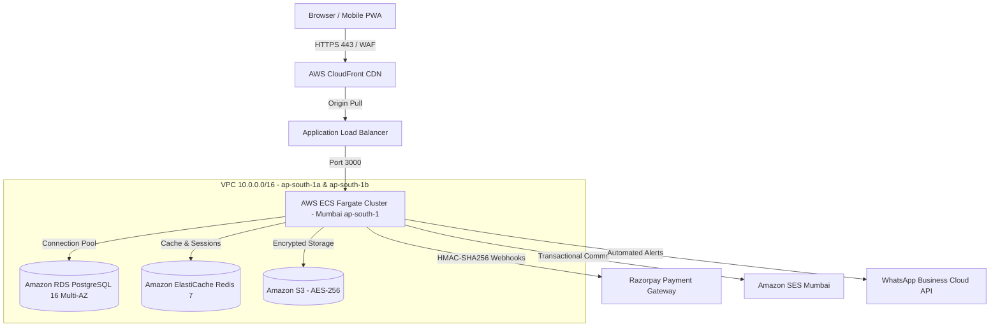

# IVR TECH SOLUTIONS PRIVATE LIMITED - Internship Portal

Building Skills. Creating Opportunities. Shaping Careers.

[](#)
[](#)
[](#)
[](#)
[](#)
[](#)

---

## Executive Overview

**IVR TECH SOLUTIONS PRIVATE LIMITED** Internship Portal is a full-stack, enterprise-grade cloud application engineered for collegiate fellows and academic mentors. It integrates a public company web presence, an administrative management suite, faculty mentorship controls, dynamic QR attendance tracking, and candidate verification.

- **Official Company Name**: IVR TECH SOLUTIONS PRIVATE LIMITED
- **Tagline**: Building Skills. Creating Opportunities. Shaping Careers.
- **Official Contact Email**: admin@ivrtechsolution.in
- **Official Internship Application**: [Google Form](https://docs.google.com/forms/d/e/1FAIpQLSc5WXW3u_3AKe4iw7QrUBzkH97ASIiyXmyifTr0cXH6cK8KdA/viewform)
- **Leadership**:
  - **I.V. Gowtham Kumar Reddy** - Chief Academic Director
  - **Shaik Asif** - VP of Enterprise Engineering

---

## 🏛 System Architecture & Topology



---

## 🚀 Administrator Credentials

The portal initializes with a clean database containing **0 demo students** and **0 demo mentors**, granting the administrator complete CRUD control.

| Role | Portal URL | Administrator Email | Password | Permissions |
| :--- | :--- | :--- | :--- | :--- |
| **Enterprise Administrator** | `/login` &rarr; `/admin` | `admin@ivrtechsolution.in` | `Admin@IVR2026!` | Student & Mentor CRUD, Excel bulk imports, security audit logs |

---

## 🔑 Key Enterprise Features

### 1. Complete Administrator Student & Mentor Governance
- **Student Management**: Add, edit, activate/deactivate, delete, view individual records, and search/filter.
- **Excel Bulk Import**: Upload student rosters via `.xlsx`, `.xls`, or `.csv` with duplicate email detection and schema validation.
- **Mentor Management**: Add, edit, activate/deactivate, delete, view individual faculty profiles, and manage cohort capacities.

### 2. Dynamic Cryptographic QR Code Attendance Engine
- Faculty mentors project a rolling dynamic QR code refreshed every **30 seconds**.
- Tokens are cryptographically signed with **HMAC-SHA256** and contain `{sessionId, batchId, timestamp, signature}`.
- Tamper-resistant: Tokens expire after 30 seconds to prevent proxy check-ins.

### 3. Public Certificate Verification Ledger
- Each completion credential features a unique ID (e.g., `IVR-CERT-2026-XXXXX`).
- Public verification seal accessible at `/verify/{certificateNumber}`.

### 4. Official Google Form Intake Workflow
- All candidate applications are routed through the official verified Google Form:
  `https://docs.google.com/forms/d/e/1FAIpQLSc5WXW3u_3AKe4iw7QrUBzkH97ASIiyXmyifTr0cXH6cK8KdA/viewform`

---

## 🛠 Local Development & Setup

### Prerequisites
- Node.js `>= 20.x`
- npm `>= 10.x`

### 1. Install Dependencies
```bash
npm install --legacy-peer-deps
```

### 2. Initialize Database & Seed Clean Baseline
```bash
# Push schema to SQLite database (dev.db)
npx prisma db push

# Run clean database reset
npx tsx prisma/seed.ts
```

### 3. Run Automated Verification Suite
```bash
node tests/run-all-tests.mjs
```

### 4. Start Development Server
```bash
npm run dev
```
Open [http://localhost:3000](http://localhost:3000) in your browser.

---

## 🔒 Security & Regulatory Compliance

- **Authentication**: JWT signed with HS256, transmitted strictly via HTTP-Only, Secure cookies.
- **Passwords**: Salted hashing with `bcryptjs` (work factor 10).
- **RBAC**: Strict role-based isolation guarding Admin, Mentor, and Student endpoints.
- **Audit Logging**: Every administrative action, profile update, and security operation is recorded in the immutable `AuditLog` table.

---

© 2026 IVR TECH SOLUTIONS PRIVATE LIMITED. All rights reserved.
